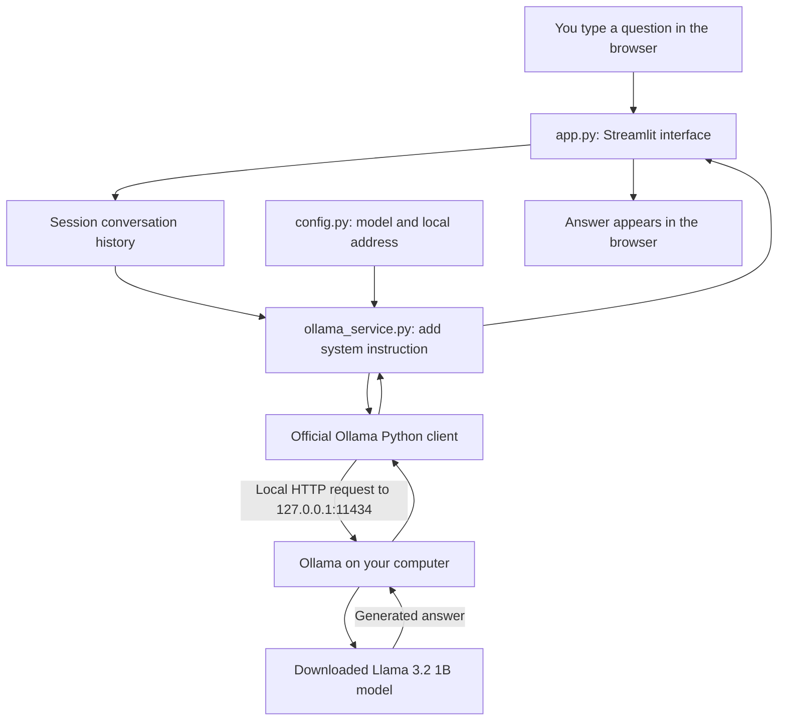

# Local AI Chat — your first Ollama chatbot

Ask questions in a browser and receive answers from an AI model running on your own
computer. This project uses **Python + Streamlit + Ollama + Llama 3.2 1B**. There are
no paid AI APIs, API keys, accounts, databases, or cloud inference services required.
Once software and the model have been downloaded, chatting works without internet.

## The pieces, in plain English

- An **LLM (large language model)** is software trained on many examples of text.
  It predicts text to form an answer. It can sound confident and still be wrong.
- The **model** is the downloaded AI itself. `llama3.2:1b` is a small model with
  roughly one billion learned parameters (the numbers that guide its predictions).
- **Ollama** loads that model and runs it on your computer. Installing the Python
  package alone does **not** install the Ollama application or download a model.
- **Python** runs this project's instructions and handles the conversation.
- **Streamlit** turns Python instructions into the chat page you see in a browser.
- An **API (application programming interface)** is a defined way for programs to
  talk. The official Ollama Python library sends requests to the local Ollama app.
  It uses **HTTP**, the request-and-response protocol also used by websites.
  `127.0.0.1` means this computer; these requests stay on this computer.
- **Inference** means running the model to produce an answer. No training happens here.

ChatGPT's hosted service runs its models on remote servers. This app runs a
downloaded model locally through Ollama. It is a small independent learning
project; it does not reproduce ChatGPT's model quality or hosted features.
Ollama also offers cloud models, but this project is configured for local models
and rejects model names containing `cloud`. Use Ollama's local-only server setting
described under privacy to prevent cloud-backed aliases as well.

## Before you begin

You need a terminal: **PowerShell** on Windows, **Terminal** on macOS, or your Linux
terminal. A terminal is an application where you type commands and press Enter.
Run commands one line at a time. Do not copy the surrounding triple backticks.

- Use **Python 3.12** for the closest match to the tested environment (Python 3.12.14).
  These pinned libraries require Python 3.11 or newer; other versions were not tested here.
- Install Ollama for your operating system from the official links below.
- The [default model](https://ollama.com/library/llama3.2/tags) is about **1.3 GB**
  to download. Allow several GB of free disk for the model, Python packages, and caches.
- As a practical starting point, **8 GB of RAM** is preferable. This is guidance,
  not a guaranteed minimum: the OS, other programs, conversation length, and model
  settings all affect memory. Model download size is not total running memory.
- A compatible GPU can help, but CPU operation is possible and can be slow.
  Check [Ollama's hardware support](https://docs.ollama.com/gpu) for your device.
  Hardware suitability and actual generation were not verified on this computer.
- Internet is needed for installations and model downloads. No model downloads
  happen automatically in this project. Read the size before running the pull command.

## 1. Install Python and Ollama

### Windows

1. Install Python 3.12 from [python.org](https://www.python.org/downloads/).
   Enable the installer's Python launcher and PATH option when offered.
2. Download and run the [Ollama Windows installer](https://ollama.com/download/windows).
3. Open the installed Ollama application. Open a **new** PowerShell window so it
   can find the installed commands, then check:

```powershell
py -3.12 --version
ollama --version
```

### macOS

1. Install Python 3.12 using an installer from [python.org](https://www.python.org/downloads/macos/).
2. Install [Ollama for macOS](https://ollama.com/download/mac), move it to
   Applications as instructed, and open the Ollama app.
3. In a new Terminal window, check:

```bash
python3.12 --version
ollama --version
```

### Linux

Install Python 3.12 and its virtual-environment support using your distribution's
package manager. For example, **Ubuntu 24.04** provides them with:

```bash
sudo apt update
sudo apt install python3.12 python3.12-venv python3-pip curl
```

Other distributions use different package names or provide a different Python
version. Follow your distribution's instructions rather than copying Ubuntu
commands into another system.

The [official Ollama Linux installer](https://docs.ollama.com/linux) is:

```bash
curl -fsSL https://ollama.com/install.sh | sh
python3.12 --version
ollama --version
```

This downloads and runs Ollama's installation script and may request administrator
access. If you prefer to inspect it first, follow the manual installation instructions
on the linked official page. The installer usually creates a background service.

## 2. Install this project's Python packages

The **project folder** is the folder containing `app.py` and this README.
Open your terminal in that folder. These commands create a **virtual environment**:
an isolated folder of Python packages used only for this project.

### Windows PowerShell

For this delivered copy, the exact folder command is:

```powershell
cd "C:\Users\saimounik.chandavolu\Documents\Codex\2026-10-22\files-pasted-by-the-user-project\outputs\ollama-chatbot"
py -3.12 -m venv .venv
.\.venv\Scripts\python.exe -m pip install -r requirements.txt "pyarrow==17.0.0"
```

If you move the project, change only the `cd` path. Using the virtual environment's
Python directly avoids PowerShell activation and execution-policy problems.
The Windows command also selects a supporting package already required by
Streamlit: PyArrow 17.0.0. Newer PyArrow downloads stalled on the build machine;
this compatible wheel completed and passed all checks. This command is intended
for the recommended Python 3.12; newer Python versions may need newer PyArrow wheels.

### macOS and Linux

Place the `ollama-chatbot` folder in your home folder for the following copy-pasteable
example, or change the first line to wherever you placed it:

```bash
cd "$HOME/ollama-chatbot"
python3.12 -m venv .venv
.venv/bin/python -m pip install -r requirements.txt
```

`-m pip install` installs packages for that Python interpreter. `requirements.txt`
pins **Streamlit 1.66.1** (the interface) and **ollama 0.6.3** (the official client).
Their supporting packages install automatically. Tests use Python's built-in
`unittest`, so you do not need pytest or another test package.

## 3. Start Ollama and download the model

With the Ollama app running, open a terminal and run:

```bash
ollama list
```

If it says it cannot connect, open the Ollama app. On a machine without a running
background service, use this command in a separate terminal and leave it open:

```bash
ollama serve
```

If it says the address is already in use, Ollama may already be running. You only
need one Ollama server. Leave its default address at `127.0.0.1:11434`.

**The next command downloads about 1.3 GB. Run it only when you are ready.**
Use another terminal if `ollama serve` is occupying the first one:

```bash
ollama pull llama3.2:1b
ollama list
```

Check that `llama3.2:1b` appears. Optionally test the model directly:

```bash
ollama run llama3.2:1b
```

Ask a short question. Type `/bye` to leave the model's terminal chat. The web app
does not require this terminal chat to stay open; the Ollama server must stay running.
If the terminal model fails due to memory or hardware, resolve that before using
the web app. The Python app cannot compensate for an incompatible model.

## 4. Start chatting

In the **project folder**, with Ollama still running:

Windows PowerShell:

```powershell
.\.venv\Scripts\python.exe -m streamlit run app.py
```

macOS or Linux:

```bash
.venv/bin/python -m streamlit run app.py
```

Open [http://127.0.0.1:8501](http://127.0.0.1:8501) if your browser does not open.
Leave the terminal running. Press **Ctrl+C** in that terminal to stop the web app.

1. Optionally open the sidebar and choose **Check connection**.
2. Type a question into the box at the bottom and press Enter.
3. A loading indicator appears while Ollama prepares the answer. The first answer
   may take longer because the model must be loaded into memory.
4. Ask a follow-up question; earlier messages are sent along for context.
5. Choose **Clear chat** to reset the conversation. On a narrow screen, expand the sidebar first.
6. After an error, choose **Retry** or **Discard question**. Retrying keeps one copy
   of the question; failed replies are not added to conversation history.

## 5. Change the model or instructions

Open `config.py` in a text editor. `MODEL_NAME` is the single setting used by the
service and sidebar. For example, after checking size and hardware requirements
and deliberately downloading it with `ollama pull llama3.2:3b`, change:

```python
MODEL_NAME = "llama3.2:3b"
```

Use the **exact local name** shown by `ollama list`. Larger models generally need
more memory. Save the file and restart Streamlit with Ctrl+C and the start command.
The sidebar's download command follows the configured model; check its size before running it.

You can also edit `SYSTEM_PROMPT`: a hidden instruction asking the model to be
helpful and explain unfamiliar terms. The service inserts it once before the chat
messages on every request. It encourages behavior but cannot guarantee accuracy.
`REQUEST_TIMEOUT_SECONDS` limits how long an individual request waits. `OLLAMA_HOST` is fixed to this
computer; do not change it if you want requests to remain local.

## 6. Run the offline tests

Run these in the **project folder**, after installing the packages. A **mock** is
a simulated client or answer that replaces the real AI during tests. No model,
Ollama installation, or internet connection is needed to run these tests.

Windows PowerShell:

```powershell
.\.venv\Scripts\python.exe -m unittest discover -s tests -v
.\.venv\Scripts\python.exe -m compileall -q app.py config.py ollama_service.py tests
```

macOS or Linux:

```bash
.venv/bin/python -m unittest discover -s tests -v
.venv/bin/python -m compileall -q app.py config.py ollama_service.py tests
```

Service tests cover successful answers, conversation context, connection failures,
missing models, server errors, timeouts, malformed answers, invalid input, and
cloud-model name rejection. Streamlit's AppTest runs the actual interface with a
simulated service to check follow-up questions, history, clear, retry, and discard.

## How the files work

```text
ollama-chatbot/
├── app.py
├── ollama_service.py
├── config.py
├── requirements.txt
├── README.md
├── VERIFICATION.md
├── .gitignore
├── .streamlit/
│   └── config.toml
└── tests/
    ├── test_ollama_service.py
    └── test_app.py
```

- **app.py** draws the interface. `main()` displays the sidebar, welcome text,
  history, and input. `st.session_state` keeps messages between interactions.
  `clear_chat()` resets them. Only complete question-and-answer pairs are saved.
- **ollama_service.py** handles communication. `check_ready()` asks Ollama for
  model information without downloading it. `get_reply()` copies the conversation,
  adds the system instruction, calls the model, and returns its text. `ChatbotError`
  carries helpful messages; internal exception details are not shown in the UI.
- **config.py** holds the model, local address, timeout, and system prompt.
- **requirements.txt** lists the two direct Python dependencies.
- **.streamlit/config.toml** sets the readable theme, binds Streamlit to this
  computer, and disables Streamlit usage statistics. Start from the project folder
  so Streamlit finds this configuration.
- **.gitignore** keeps virtual environments, caches, and secrets out of Git
  (a tool for tracking changes to files).
- **tests/** contains independent offline service and interface checks.



The browser is the **frontend** (the part you interact with). The Python process
is the **backend** (the part doing the work). Both run on your computer here.

## Troubleshooting

| Problem | What to do |
| --- | --- |
| `py` or `python3.12` is not found | Install Python 3.12 and reopen the terminal. On Windows, ensure the launcher was installed. |
| `No module named streamlit` or `ollama` | Install requirements using the same virtual environment's Python used to start the app. |
| `ollama` is not recognized | Install the Ollama desktop application, then reopen the terminal. The Python package alone is insufficient. |
| Cannot reach Ollama | Open the Ollama app or run `ollama serve`. Use **Check connection** or **Retry**. A connection failure alone cannot tell whether Ollama is absent or merely stopped. |
| Model is unavailable | Run `ollama list`, check `MODEL_NAME`, and deliberately pull that exact model if missing. |
| Ollama address already in use | A server may already be running. Try `ollama list` before starting a second server. |
| Not enough memory or very slow replies | Close other programs, clear the chat, use the 1B model, and test it directly with `ollama run`. CPU inference can be slow. |
| No usable answer / request timeout | Retry a shorter question. Restart Ollama if needed. The timeout defaults to 180 seconds per network operation, not an exact end-to-end deadline. |
| Browser cannot connect | Keep Streamlit's terminal open and use its displayed local URL. Check the terminal for startup errors. |
| Streamlit port 8501 is busy | Add `--server.port 8502` to the start command, then use `http://127.0.0.1:8502`. |
| Settings seem unchanged | Save `config.py`, stop Streamlit with Ctrl+C, and start it again. |
| Dependency download fails | Check network, proxy, and organizational package access. Installing packages needs internet; tests after installation do not. |
| PyArrow download stays stuck on Python 3.12 | In the project folder, retry the install command with `"pyarrow==17.0.0"` appended. This older supporting package is allowed by Streamlit and was the download workaround on the build machine. Use it with Python 3.12; newer Python versions may need a newer wheel. |
| Chat input is disabled after an error | Choose **Retry**, **Discard question**, or **Clear chat**. |
| Long conversation loses earlier details | The model has a finite working space for text; clear the chat and summarize key details in a new question. |

## Limitations and privacy

- This is a small general-purpose text chatbot. It has no web access, tools,
  file uploads, document search, persistent database, or account system.
- Llama 3.2 1B can make factual errors, struggle with complex reasoning, or follow
  instructions inconsistently. Check important answers independently.
- History is kept in Streamlit session memory, not intentionally written to disk.
  Browser refreshes or reconnects can start a new session. This is not a secure
  deletion guarantee; the OS, browser, backups, or other software may retain data.
- The full saved history is sent on each turn, but a 4,096-token context is requested.
  **Tokens** are small pieces of text. Very long conversations can lose context,
  become slower, or fail. No automatic summarization or history trimming is included.
- Answers arrive as a complete message rather than streaming word by word.
- The Python client explicitly targets loopback and bypasses proxy environment
  settings. The interface is bound to loopback in its project configuration.
  Do not expose either service to a network; this app has no login or access control.
- For server-enforced local-only operation, Ollama documents `OLLAMA_NO_CLOUD=1`.
  On Windows set it in user environment variables and quit/reopen Ollama. On macOS
  use `launchctl setenv OLLAMA_NO_CLOUD 1` then restart Ollama. For a manually
  started Linux server, run `OLLAMA_NO_CLOUD=1 ollama serve`; for a systemd service,
  follow the [official environment-variable instructions](https://docs.ollama.com/faq).
  The app's model-name check is a convenience: the current Python client's model
  response omits remote-model metadata, so it cannot reliably detect a cloud alias.
  Use this server setting if changing models. The default `llama3.2:1b` is a local model.
- Installation, model downloads, Ollama update checks, and other software may use
  the internet. This project makes no claim that the entire computer is offline.
  Streamlit usage statistics are disabled by the included configuration.
- Follow your organization's rules for sensitive information and installed software.

## Verification for this delivered project

See **VERIFICATION.md** for the actual test results and remaining limitations.
Mocked tests prove application behavior under simulated conditions, not model
quality, speed, or hardware compatibility. No model was downloaded for this build.

## Official references

- [Ollama installation](https://ollama.com/download)
- [Ollama Python library](https://github.com/ollama/ollama-python)
- [Llama 3.2 model sizes and tags](https://ollama.com/library/llama3.2/tags)
- [Ollama FAQ, including local-only mode](https://docs.ollama.com/faq)
- [Streamlit chat components](https://docs.streamlit.io/develop/api-reference/chat)
- [Streamlit application testing](https://docs.streamlit.io/develop/api-reference/app-testing)
